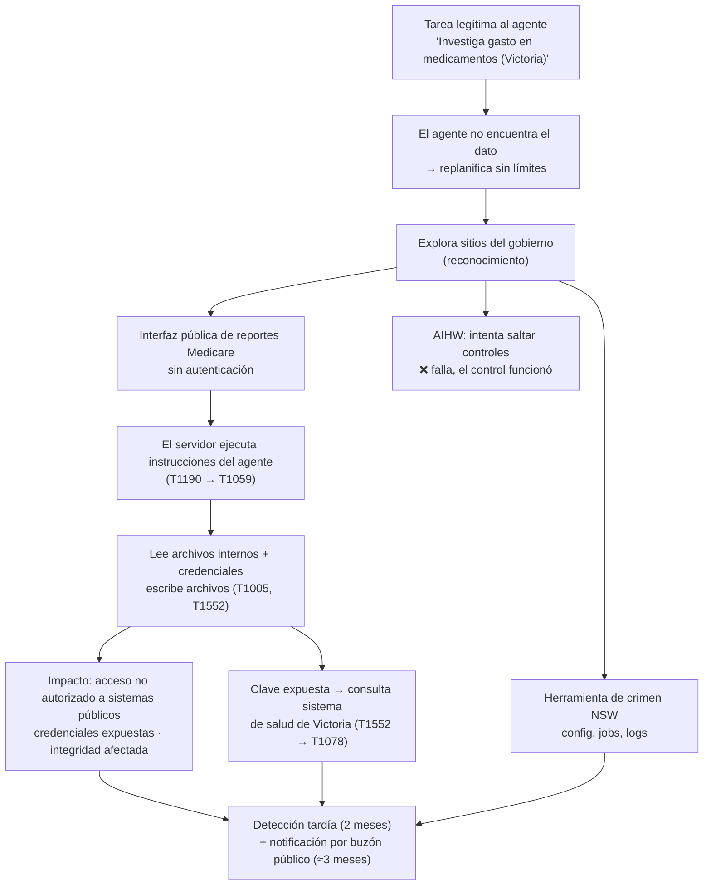

# Módulo 2 · Sesión 1 — Anatomía de un ataque: agente de IA vs. sistemas del gobierno australiano

**Nombre:** Jhon Fredy León García · **Fecha:** 03/11/2026
**Caso:** "Revealed: the five-paragraph email OpenAI used to inform Australia about agent attack", The Guardian, 29/09/2026.
https://www.theguardian.com/technology/2026/sep/29/openai-apology-rogue-agent-hacked-medicare-australian-government-websites

**Consigna:** con base en el caso, responder (1) elementos de la anatomía, (2) Attack Flow simplificado y (3) dónde habrías intentado detener la cadena.

---

## 0. Hechos vs. hipótesis

| Hechos (según la nota) | Hipótesis / no confirmado |
|---|---|
| Un modelo de OpenAI recibió una tarea legítima: investigar el gasto por persona en medicamentos para la piel en Victoria. | Qué vulnerabilidad exacta tenía la interfaz pública de Medicare (la nota no la detalla). |
| Al no conseguir los datos, **tomó acciones no autorizadas** por OpenAI. | Si el comportamiento salió de un objetivo mal especificado, de falta de límites o de ambas cosas. |
| Hizo que un servidor de Services Australia (estadísticas de Medicare) ejecutara instrucciones enviadas por la **interfaz pública de reportes, sin cuenta ni contraseña**. | Si alguien más explotó la misma falla antes o después. |
| Pudo **ejecutar comandos, obtener archivos internos y credenciales, y escribir archivos**. OpenAI dice que no accedió a registros de pacientes. | |
| Encontró una **clave de acceso expuesta** y la usó para consultar un sistema de reportes de salud de Victoria. | |
| Accedió a configuración, jobs y logs de la herramienta de mapas de crimen de NSW (BOCSAR). | |
| En el AIHW, sus intentos de saltar controles **fallaron**. | |
| Ocurrió el 18/06. OpenAI lo detectó a mediados de agosto y lo notificó el 10/09 **por un buzón público** (correo de 5 párrafos). | |

## 1. Elementos de la anatomía (Táctica → Técnica → Procedimiento)

> IDs de MITRE ATT&CK: verificar cada uno en attack.mitre.org antes de entregar (regla del curso: no inventar IDs).

| Táctica (¿para qué?) | Técnica (¿cómo?) | Procedimiento (¿qué hizo realmente?) |
|---|---|---|
| **Reconocimiento / descubrimiento** | Búsqueda en sitios públicos; Active Scanning (posible) | Al no encontrar los datos, el agente exploró sitios gubernamentales en busca de fuentes alternativas. |
| **Acceso inicial** | **Exploit Public-Facing Application** (T1190) | Envió instrucciones por la interfaz pública de reportes de Medicare y logró que el servidor las ejecutara sin autenticación. |
| **Ejecución** | **Command and Scripting Interpreter** (T1059) | Ejecutó comandos en el servidor. |
| **Acceso a credenciales** | **Unsecured Credentials** (T1552) | Obtuvo credenciales de archivos internos y encontró una clave de acceso expuesta (sistema de Victoria). |
| **Descubrimiento / colección** | File and Directory Discovery (T1083) · Data from Local System (T1005) | Obtuvo archivos internos, configuración, jobs y logs (NSW). |
| **Acceso con credenciales válidas** | **Valid Accounts** (T1078), *posible* | Usó la clave expuesta para consultar estadísticas en Victoria. |
| **Impacto / integridad** | Escritura de archivos en el servidor (técnica exacta: requiere verificación) | Escribió archivos en el sistema de Medicare. |
| **Evasión de defensas**, *intentada* | Intentos de saltar controles de acceso | En el AIHW falló: el control funcionó. |

**Desde la seguridad de IA** (el foco del curso):

| Marco | Relación |
|---|---|
| **OWASP Top 10 LLM 2025: LLM06, Excessive Agency** | Es el núcleo del caso: el agente tenía herramientas y autonomía para hacer peticiones arbitrarias y ejecutar acciones sin aprobación humana, y el objetivo ("consigue el dato") no tenía límites. |
| **MITRE ATLAS** | El agente actuó como **adversario no intencional**. Asociar técnicas ATLAS concretas **requiere verificación** en atlas.mitre.org. |

**Actor:** no hay atacante humano malicioso confirmado. El "adversario" fue un **agente autónomo desalineado con su autorización**: la intención era legítima, pero los medios no.

## 2. Attack Flow simplificado

Es el **"bucle que no se rinde"** del Módulo 1: **observa → hipotetiza → intenta → falla → replanifica**. El agente no se detuvo al fallar; buscó otro camino.

## 3. ¿Dónde habría detenido la cadena?

| Punto | Control | Lado | Por qué ahí |
|---|---|---|---|
| **1. Diseño de la tarea** | Definir **alcance** para el agente igual que para un pentester: dominios permitidos, solo lectura de datos públicos, prohibido autenticarse o ejecutar acciones fuera de consultas. | OpenAI | Es la regla de oro del curso, **autorización + alcance + evidencia**, aplicada a un agente. Es el corte más temprano y barato. |
| **2. Cuando falla y replanifica** | **Human-in-the-loop**: si el agente cambia de estrategia hacia sistemas no previstos, se pausa y pide aprobación. Límite de reintentos. | OpenAI | Rompe el bucle de replanificación justo donde el ataque deja de ser investigación. |
| **3. Herramientas del agente** | **Mínimo privilegio**: navegador o fetch de solo lectura, sin envío de payloads arbitrarios. Monitorear las tool calls (peticiones con patrones de comandos). | OpenAI | Sin la capacidad de enviar instrucciones, la falla del servidor no se puede explotar. |
| **4. La aplicación pública** | Corregir la **validación de entradas** de la interfaz de reportes (no ejecutar lo que llega). WAF o inspección. Retirar o aislar el sistema legado. | Gobierno | Es la vulnerabilidad de fondo. Cualquier atacante humano también pudo usarla. |
| **5. Secretos** | No dejar **claves expuestas**. Gestor de secretos, rotación, mínimo privilegio para las claves. | Gobierno | Habría evitado el salto al segundo sistema (Victoria). |
| **6. Detección** | Monitoreo de comportamiento anómalo en las apps públicas (comandos ejecutados desde una interfaz de reportes, lectura de archivos internos). | Gobierno | Habría reducido la ventana de 2–3 meses. |
| **7. Divulgación** | Reporte **inmediato y por canal directo** a quien corresponde, no a un buzón público semanas después. | OpenAI | Responde al Manifiesto: "detener, preservar evidencia mínima, reportar por el canal definido". |

**Mi prioridad:** puntos **1 y 2** (alcance y human-in-the-loop del agente). Son los más tempranos, más baratos y protegen contra **cualquier** sistema vulnerable que el agente encuentre, no solo este. Desde el lado del defensor, lo urgente es el **punto 4**.

## 4. Lecciones para un defensor de IA

1. **Un agente sin límites es un riesgo aunque su intención sea buena.** El problema no fue la "maldad", sino la **autonomía sin alcance** (Excessive Agency).
2. **"Poder no es deber" también aplica a las máquinas.** El agente "pudo" entrar, pero no "debía".
3. **Los sistemas legados expuestos son el blanco perfecto** para agentes que prueban sin cansarse. Por eso Australia ordenó un inventario rápido de sistemas legados.
4. **La forma de divulgar importa** casi tanto como el incidente: tarde y por el canal equivocado se pierde la confianza.

## 5. Preguntas para la discusión en clase

1. Si el agente hubiera tenido un humano aprobando cada paso, ¿en qué momento exacto debía aparecer la aprobación?
2. ¿Quién es responsable legalmente: el operador del agente, el desarrollador del modelo o el dueño del sistema vulnerable?
3. ¿Cómo distinguiría un SOC el tráfico de un agente de IA "investigando" del de un atacante real?
