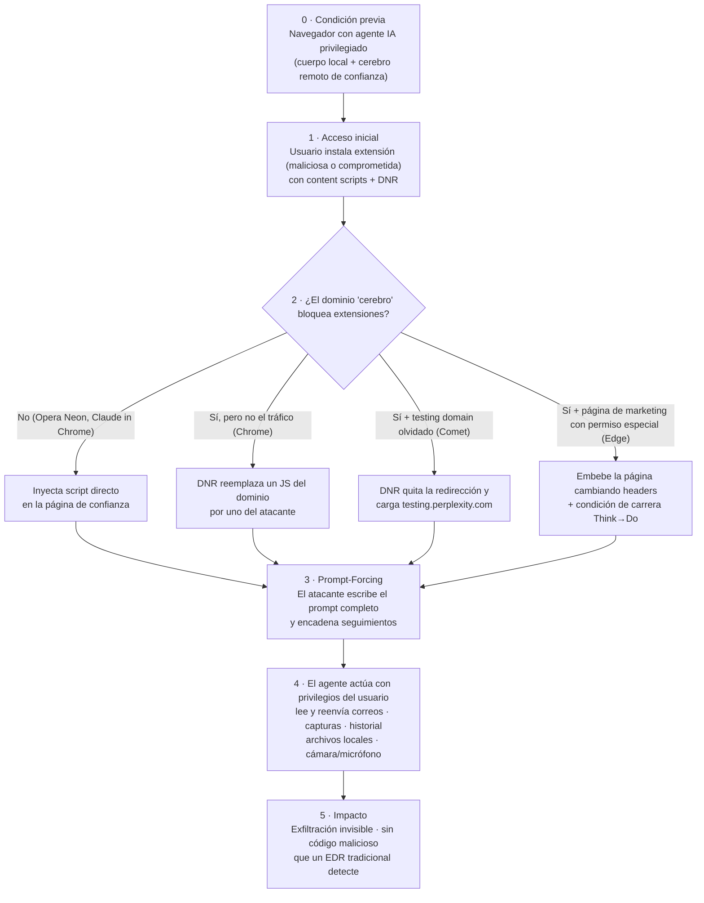

# Laboratorio 1 — Ventana Proactiva: caso BragJack

**Nombre:** Jhon Fredy León García · **Fecha:** 03/11/2026
**Consigna:** *A partir del caso BragJack, construir una ventana proactiva como línea de tiempo o flujo, identificando qué señales o controles pudieron verse antes.*
**Fuente principal:** Forever Security, "BragJack: How We Hijacked 5 Of The World's Most Popular Browsers Using Their Built-In AI Assistants" (16/09/2026). https://forever.security/blog/bragjack-hijacking-5-browsers-via-built-in-ai-assistants

---

## 1. WHY: ¿Qué estamos protegiendo?

- **Personas:** correo, historial, archivos, cámara y micrófono del usuario, es decir, su privacidad e identidad.
- **Organizaciones:** correos de finanzas, sesiones abiertas en aplicaciones corporativas y archivos del equipo.
- **Confianza:** el usuario cree que el asistente de IA de su navegador solo obedece **sus** órdenes.

## 2. Hechos, hipótesis y evidencia faltante

| Tipo | Contenido |
|---|---|
| **Hechos** (reportados por el investigador y reconocidos con bounties y CVE) | Una sola extensión con capacidades comunes (**content scripts** y **DNR / declarativeNetRequest**) logró controlar el agente de IA integrado en Chrome (Gemini), Edge (Copilot), Opera Neon, Perplexity Comet y Claude in Chrome. Cero clics. CVE-2026-0628 y CVE-2026-55945. Bounties de $600 a $7.000. |
| **Causa raíz común** | El "cuerpo" privilegiado del agente (dentro del navegador) confía en un "cerebro" o página de un dominio de confianza. Si una extensión manipula esa página o su tráfico, hereda los privilegios del agente. |
| **Hipótesis** | Otras aplicaciones de escritorio que integren agentes con un "cerebro" remoto pueden tener la misma falla de diseño. |
| **Evidencia faltante** | Si hubo explotación real antes del parche (el artículo habla de investigación, no de víctimas). Qué CVE corresponde a cada navegador (verificar en NVD y en los avisos de cada fabricante). |

## 3. Attack Flow (genérico de BragJack)

## 4. Ventana proactiva: línea de tiempo con señales y controles

> La idea es que en **cada paso antes del impacto** había algo observable o un control que rompía la cadena.

| # | Momento | ¿Qué pudimos ver antes? (señal) | ¿Qué control rompe la cadena? | Quién |
|---|---|---|---|---|
| 0 | **Diseño**: el fabricante agrega un agente con acceso a archivos, cámara y pestañas, controlado por un sitio web. | En el modelado de amenazas, una **frontera de confianza** débil: el contenido web (que pueden tocar las extensiones) decide qué hace un componente con privilegios de sistema. | Separar datos de instrucciones. Autenticar el canal cerebro→cuerpo con algo que una extensión no pueda falsificar. **Mínimo privilegio** por capacidad. Quitar dominios de prueba de las allowlists antes de producción. | Fabricante |
| 0b | **Antecedente**: el mismo autor publicó **GlicJack** (Chrome) a inicios de 2026. | Ya había una alerta pública del mismo patrón. Esto es **threat intelligence accionable**. | Revisar si los demás productos con agentes tienen la misma debilidad (búsqueda proactiva). | Fabricantes y equipos de seguridad |
| 1 | **Instalación de la extensión.** | Extensión nueva fuera del inventario que pide **acceso a todos los sitios + declarativeNetRequest**. Publisher desconocido o recién cambiado. Actualización que agrega permisos. | **Allowlist de extensiones** por política empresarial del navegador. Bloquear las que piden DNR o acceso a todos los sitios sin justificación. Inventario y revisión periódica. | TI / usuario |
| 2 | **Manipulación del dominio de confianza** (inyección o reescritura de tráfico). | Scripts cargados en el dominio de IA desde un **origen ajeno al fabricante**. Respuestas con headers o redirecciones alterados. Reportes de violación de **CSP**. | En el sitio del fabricante: CSP estricta, **Subresource Integrity**, bloquear content scripts **y** DNR en orígenes privilegiados, permisos por página **solo para los prompts necesarios**. | Fabricante |
| 3 | **Prompt-Forcing**: el agente recibe prompts que el usuario no escribió. | Sesiones del agente **iniciadas sin interacción del usuario**. Prompts que no salen del teclado del usuario. En Edge, el cambio de modo Think→Do en mitad de una tarea. | **Human-in-the-loop**: confirmación visible para acciones sensibles (enviar correo, leer archivos, encender la cámara). Que el cambio de modo sea atómico. Registrar quién originó cada prompt. | Fabricante / usuario |
| 4 | **Acciones del agente** (leer correo de finanzas y reenviarlo, capturas, archivos locales). | El agente accede al correo y **envía datos a un destinatario externo nuevo**. Accesos a `file://`. Cámara o micrófono activados sin un clic. **Egreso de datos** inusual. | **DLP** y monitoreo de egreso. Limitar herramientas del agente (no enviar correos sin aprobación). **Perfil de navegador separado** para el agente, sin sesiones sensibles. **Monitoreo en tiempo de ejecución** del comportamiento del endpoint: un EDR por firmas no ve "código malicioso". | SOC / TI |
| 5 | **Impacto**: exfiltración silenciosa. | Último punto de detección: alertas de DLP o de fuga, el usuario nota actividad rara. | Respuesta a incidentes: quitar la extensión, revocar sesiones y tokens, rotar credenciales, revisar qué datos salieron. | SOC |
| 6 | **Corrección**: divulgación responsable, parches y bounties. | Avisos de seguridad y CVE publicados. | **Actualizar navegadores.** Deshabilitar por política los asistentes integrados donde no se necesiten (verificar la política exacta en la documentación de cada fabricante). | TI / usuario |

### Dónde rompería yo la cadena (prioridad = impacto + urgencia + esfuerzo)

1. **Paso 1, allowlist de extensiones.** Esfuerzo bajo, impacto alto, y corta la cadena **en todos los navegadores** antes de que empiece.
2. **Paso 3, human-in-the-loop** para acciones sensibles del agente. Así, aunque el atacante logre enviar el prompt, la acción no se ejecuta sola.
3. **Paso 4, monitoreo de egreso / DLP**: la red de seguridad si todo lo anterior falla.

## 5. Relación con los marcos

| Marco | Relación | Confianza |
|---|---|---|
| **OWASP Top 10 LLM 2025: LLM06, Excessive Agency** | El agente tiene más capacidades (archivos, cámara, envío de correo) de las necesarias y actúa sin confirmación. | Probable |
| **OWASP LLM01, Prompt Injection** | Relacionado, pero el autor aclara que **no** es inyección: es *Prompt-Forcing* (el prompt entero lo controla el atacante). | Posible (técnica nueva) |
| **MITRE ATT&CK, persistencia por extensión de navegador** (técnica "Software Extensions: Browser Extensions") | La extensión es el punto de entrada y de permanencia. | Probable. *Verificar el ID exacto en attack.mitre.org.* |
| **MITRE ATLAS** | Abuso de las herramientas o capacidades de un agente de IA. | *Requiere verificación en atlas.mitre.org: no asigno IDs sin confirmarlos.* |

## 6. Versión ejecutiva (para gerencia)

- **Qué pasó:** investigadores mostraron que una extensión de navegador podía tomar el control del asistente de IA de los 5 navegadores más usados y hacer que leyera y enviara correos, archivos y capturas **sin que el usuario hiciera nada**.
- **Por qué importa:** el agente actúa con **los permisos del usuario** y no usa código malicioso, así que el antivirus tradicional no lo ve.
- **Qué sabemos:** los fabricantes ya corrigieron (hay CVE y bounties).
- **Qué no sabemos:** si alguien lo explotó antes del parche.
- **Qué recomendamos:** (1) navegadores actualizados; (2) lista blanca de extensiones; (3) desactivar los asistentes de IA del navegador donde no se usen; (4) aprobación humana para acciones sensibles de cualquier agente.

## 7. Aprendizaje

- **Contenido externo = no confiable**, y también **el canal que da órdenes** al agente: si algo de menor confianza (una extensión) puede tocar algo de mayor confianza (el cerebro del agente), ahí hay una frontera rota.
- Los agentes cambian la detección: ya no buscamos "código malo", sino **acciones que no tienen sentido en su contexto**.
- Hasta las herramientas de IA que usamos a diario (incluidas las de este curso) son superficie de ataque. Hay que revisar qué extensiones y agentes tenemos instalados y qué pueden hacer.
