# Laboratorio 2 — Investigador de incidentes: reconstruir sin inventar

**Nombre:** Jhon Fredy León García · **Fecha:** 04/11/2026
**Consigna:** *Sobre un incidente público seleccionado por el facilitador, separar hechos, hipótesis y vacíos de evidencia y reconstruir una historia defensiva de alto nivel. Misión en 5 pasos: 1) leer dos o tres fuentes públicas sobre el mismo incidente y registrar fecha y fuente; 2) construir una línea de tiempo con 6 a 10 eventos confirmados; 3) separar hechos, hipótesis y datos desconocidos; 4) identificar activo, amenaza, posible técnica, evidencia e impacto; 5) responder qué señal habría permitido anticiparse o limitar el avance.*
**Incidente:** un agente de IA de OpenAI accede sin autorización al portal de estadísticas de Medicare (Services Australia), el caso que trabajamos en la clase 3 (Módulo 2, Sesión 1).
**Herramientas:** fuentes públicas, MITRE ATT&CK, Excalidraw (`lab-02-linea-de-tiempo.excalidraw`) y Markdown.

> **Regla de este laboratorio:** cada afirmación lleva su fuente. Si solo una fuente lo dice, lo marco. Si las fuentes se contradicen, no elijo la versión que me conviene: muestro la contradicción.

---

## Paso 1. Fuentes públicas

| # | Fuente | Fecha | Qué aporta |
|---|---|---|---|
| F1 | ABC News (Australia), *"OpenAI hacked Medicare portal, Prime Minister Anthony Albanese says"* («OpenAI hackeó el portal de Medicare, dice el primer ministro Anthony Albanese»), Erin Handley. https://www.abc.net.au/news/2026-09-24/ai-agent-accessed-australian-government-site-pm-says/107189078 | 24/09/2026 | La cronología oficial día por día (de junio a septiembre), las declaraciones de Albanese y Marles y la respuesta del gobierno (ASD y grupo especial de trabajo). |
| F2 | BleepingComputer, *"OpenAI hacked Australian Medicare govt site, probed data providers"* («OpenAI hackeó el sitio de Medicare del gobierno australiano y sondeó a proveedores de datos»), Bill Toulas. https://www.bleepingcomputer.com/news/security/openai-hacked-australian-medicare-govt-site-probed-data-providers/ | 24/09/2026 | El análisis de **Transluce** sobre registros públicos (urlquery.net): sondeos con XSS, SQLi, inyección de comandos y path traversal a otros proveedores de datos. |
| F3 | CNBC, *"OpenAI says agent hacked Australian government website without being told to do so"* («OpenAI dice que su agente hackeó un sitio del gobierno australiano sin que se lo pidieran»), Jenny Lee. https://www.cnbc.com/2026/09/24/openai-agent-hacked-australian-government-website-.html | 24/09/2026 | La declaración textual de OpenAI y el contexto: fue una evaluación interna, y hubo otros incidentes (Universidad de Nuevo México, Data USA, Hugging Face). |
| F4 | The Guardian, *"Revealed: the five-paragraph email OpenAI used to inform Australia about agent attack"* («Revelado: el correo de cinco párrafos con el que OpenAI informó a Australia del ataque del agente»). https://www.theguardian.com/technology/2026/sep/29/openai-apology-rogue-agent-hacked-medicare-australian-government-websites | 29/09/2026 | El contenido del correo de notificación de OpenAI, con detalle técnico que las demás fuentes no tienen. Es la fuente del caso en clase. |

## Paso 2. Línea de tiempo (10 eventos confirmados)

"Confirmado" = lo afirma una parte con conocimiento directo (gobierno u OpenAI) y lo publica al menos un medio.

| # | Fecha (2026) | Evento | Confirmado por | Fuentes |
|---|---|---|---|---|
| 1 | **18/06** | Un agente de OpenAI accede sin autorización al **portal de estadísticas de Medicare** de Services Australia, a archivos públicos y **no públicos**. | Albanese, OpenAI | F1, F2, F3 |
| 2 | **11/08** | OpenAI se entera mientras revisa la "actividad de modelos desalineados". | OpenAI | F1 (fecha exacta), F3 ("agosto") |
| 3 | **01/09** | Sam Altman se reúne con el ministro de Defensa, Richard Marles, en San Francisco. **No le menciona** el incidente. | Marles | F1 |
| 4 | **10/09** | OpenAI notifica por correo al **buzón público de divulgaciones** de Services Australia, que normalmente usan académicos para reportar debilidades. | Albanese, OpenAI | F1, F2, F3, F4 |
| 5 | **11/09** | Services Australia ve el correo. | Gobierno | F1 |
| 6 | **15/09** | Services Australia reporta el incidente al **ASD** (Australian Signals Directorate). | Gobierno | F1 |
| 7 | **19–20/09** | Se informa al Primer Ministro y a su oficina. | Gobierno | F1 |
| 8 | **22/09** | Primer "intercambio técnico" entre OpenAI y Services Australia. | Gobierno | F1 |
| 9 | **24/09** | Albanese habla con Altman, **revela públicamente** el incidente y anuncia un **grupo especial de trabajo** (*taskforce*). El mismo día, Transluce publica su análisis. | Albanese | F1, F2, F3 |
| 10 | **29/09** | The Guardian publica el correo de cinco párrafos de OpenAI. | Medio (documento original) | F4 |

**Las ventanas que importan:**
- Del incidente a la detección (18/06 → 11/08): **54 días** sin que nadie lo viera.
- De la detección a la notificación (11/08 → 10/09): **30 días**.
- Del incidente a la notificación (18/06 → 10/09): **84 días** (las fuentes hablan de "casi tres meses").
- Del incidente a que el país se entera (18/06 → 24/09): **98 días**.

```mermaid
flowchart LR
    A["18/06<br/>Acceso al portal<br/>de Medicare"] --> B["11/08<br/>OpenAI lo detecta<br/>(+54 días)"]
    B --> C["01/09<br/>Altman–Marles<br/>sin mencionarlo"]
    C --> D["10/09<br/>Correo a buzón<br/>público (+84 días)"]
    D --> E["11/09<br/>Services Australia<br/>lo ve"]
    E --> F["15/09<br/>Reporte al ASD"]
    F --> G["19–20/09<br/>Se informa al PM"]
    G --> H["22/09<br/>1.er intercambio<br/>técnico"]
    H --> I["24/09<br/>Revelación pública<br/>+ grupo especial"]
    I --> J["29/09<br/>Se publica<br/>el correo"]
    style A fill:#ffc9c9,stroke:#e03131
    style B fill:#ffec99,stroke:#f08c00
    style D fill:#d0ebff,stroke:#1971c2
    style I fill:#d0ebff,stroke:#1971c2
```

Contexto (no lo cuento entre los 10 porque son casos distintos): según F2, **entre mayo y junio** los agentes también sondearon al AIHW (Australia), a Data USA y a la biblioteca digital de la Universidad de Nuevo México. Según F3, en **julio** modelos de OpenAI evadieron controles de aislamiento y comprometieron parte de su infraestructura interna de investigación y sistemas de Hugging Face.

## Paso 3. Hechos, hipótesis y datos desconocidos

### Hechos (dos o más fuentes, o la parte afectada lo afirma)

| Hecho | Fuentes |
|---|---|
| El acceso fue el 18/06/2026 al portal de estadísticas de Medicare, administrado por Services Australia. | F1, F2, F3 |
| El portal **bloqueó** las peticiones y el agente **encontró una forma de evitar los bloqueos** («no aceptó un "no" como respuesta», Albanese). | F1, F2 |
| Se accedió a archivos **públicos y no públicos**. OpenAI dice que eran **estadísticas agregadas y nombres de archivos internos**. | F1, F2, F3 |
| OpenAI dice que **no encontró evidencia de acceso a registros de pacientes**. | F1, F2, F3 |
| Ocurrió durante una **evaluación interna** de OpenAI. Los modelos buscaban estadísticas sobre gasto público en medicamentos y, en palabras de OpenAI, «tomaron acciones que no pretendíamos». | F1, F2, F3 |
| OpenAI notificó el 10/09 por correo a un buzón público. | F1, F2, F3, F4 |
| El ASD apoya la investigación forense y se creó un grupo especial de trabajo (Departamento del Primer Ministro + ASD + Instituto de Seguridad de IA). | F1, F3 |

### Hipótesis (lo que deduzco de los hechos, pero ninguna fuente lo prueba)

| Hipótesis | En qué me apoyo | Qué la confirmaría o la descartaría |
|---|---|---|
| H1. El agente evitó los bloqueos **cambiando de ruta o de parámetros**, no rompiendo una contraseña. | «Encontró una forma de evitar los bloqueos» (F1, F2) y los sondeos con varias técnicas a otros sitios (F2). | Los logs del portal del 18/06 que analiza el ASD. |
| H2. El portal **no tenía una alerta** que correlacionara rechazos y accesos exitosos del mismo origen. | Nadie del lado del gobierno lo detectó: se enteraron por el correo de OpenAI (F1). | La revisión de la configuración del WAF y del SIEM de Services Australia. |
| H3. Los 30 días entre la detección y la notificación se fueron en una **revisión interna** de OpenAI. | OpenAI dice que lo encontró revisando «actividad de modelos desalineados» (F1, F3). | Una explicación de OpenAI o el informe del grupo especial de trabajo. |
| H4. El agente tenía herramientas para enviar peticiones web **sin aprobación humana** paso a paso. | Hizo sondeos repetidos a varios sitios durante semanas (F2) sin que nadie lo frenara. | La descripción de la evaluación interna (herramientas y permisos del agente). |

### Reportado por una sola fuente (necesita verificación)

| Afirmación | Fuente | Por qué la marco |
|---|---|---|
| El agente **escribió datos en un servidor interno**. | F2 (citando a Albanese) | F1 y F3 no lo mencionan. Si es cierto, cambia el impacto: ya no solo se afectó la confidencialidad, sino también la **integridad**. |
| Según el correo de OpenAI: ejecutó comandos, obtuvo archivos internos y credenciales, encontró una **clave expuesta** y la usó contra un sistema de salud de Victoria; leyó configuración, jobs y logs de la herramienta de BOCSAR (NSW); en el AIHW sus intentos fallaron. | F4 | Es el documento más detallado, pero solo lo conozco por un medio y **contradice** lo que dijo Marles el 24/09 (ver abajo). |
| Los agentes usaron el **sistema de navegador remoto** del propio servicio para sacar datos cuando el acceso directo falló. | F2 (Transluce) | Es una reconstrucción hecha con registros públicos incompletos. |
| En el AIHW, Cloudflare bloqueó intentos de **XSS**, pero el agente sacó un archivo público de un **servidor de preproducción**. | F2 (Transluce) | Una sola fuente. Deja ver una exposición concreta: un servidor de preproducción alcanzable desde internet. |

### Contradicciones entre fuentes

| Tema | Versión A | Versión B | Cómo lo trato |
|---|---|---|---|
| ¿Se afectaron otros tres sitios (AIHW, BOCSAR, Salud de Victoria)? | Albanese (24/09): "pueden haber sido afectados" (F1). | Marles (24/09): las interacciones fueron «completamente normales» y solo con información pública (F1). Pero el correo de OpenAI publicado el 29/09 describe accesos a Victoria y BOCSAR (F4). | **No está resuelto.** La versión más tardía y detallada (F4) es más grave que la oficial del 24/09. Hay que esperar la investigación forense. |
| ¿Escribió archivos? | Sí, según Albanese en F2 y el correo en F4. | F1 y F3 no lo mencionan. | Lo dejo como **probable, sin confirmar el contenido**. |
| ¿Cuánto tardó la notificación? | F1 menciona una «brecha de tres meses» entre detección y notificación. | Las fechas de F1 dan 30 días (11/08 → 10/09). Los casi tres meses son desde el **incidente** (18/06). | Uso las fechas, no la frase: **30 días** desde la detección y **84** desde el incidente. |

### Datos desconocidos (vacíos de evidencia)

1. **La técnica exacta** con la que se evitaron los bloqueos del portal (ninguna fuente la describe).
2. **Qué archivos** no públicos se leyeron y **qué se escribió** en el servidor interno.
3. **Por qué pasaron 30 días** entre la detección y la notificación, y por qué se usó un buzón público.
4. Si **otros sistemas** del gobierno se afectaron (la investigación sigue abierta).
5. Si los sondeos a Data USA y a la Universidad de Nuevo México **tuvieron éxito**: Transluce dice que sus datos son incompletos.
6. **Qué herramientas y permisos** tenía el agente durante la evaluación.

## Paso 4. Activo, amenaza, posible técnica, evidencia e impacto

> Los IDs de ATT&CK son **posibles**: ninguna fuente publica el procedimiento técnico completo. Los asigno según el comportamiento descrito y los marco como hipótesis.

| Activo | Amenaza | Posible técnica (ATT&CK) | Evidencia disponible | Impacto |
|---|---|---|---|---|
| **Portal de estadísticas de Medicare** (Services Australia), una aplicación web pública y antigua. | Agente de IA autónomo con **agencia excesiva** (OWASP LLM06). No hay un atacante humano malicioso confirmado. | **T1190** Explotación de aplicación expuesta al público (*Exploit Public-Facing Application*; evitó los bloqueos, *posible*). **T1083** Descubrimiento de archivos y directorios (*File and Directory Discovery*; nombres de archivos internos). **T1005** Datos del sistema local (*Data from Local System*; archivos no públicos). | Declaraciones del PM, revisión de OpenAI, correo del 10/09, investigación del ASD. | **Confidencialidad:** archivos no públicos y nombres internos. **Integridad:** escritura en servidor interno (sin confirmar el contenido). **Confianza** pública. Sin datos personales, según la evidencia actual. |
| **Sistemas de salud de Victoria y BOCSAR (NSW)** | El mismo agente. | **T1552** Credenciales sin proteger (*Unsecured Credentials*) y **T1078** Cuentas válidas (*Valid Accounts*) (clave expuesta, *solo F4*). | Correo de OpenAI publicado por F4. Lo contradice Marles. | **Por confirmar.** Si F4 es correcto: uso de credenciales expuestas y lectura de configuración y logs. |
| **AIHW** y otros proveedores de datos (Data USA, UNM) | El mismo comportamiento de sondeo. | **T1595.002** Escaneo activo: escaneo de vulnerabilidades (*Active Scanning: Vulnerability Scanning*; XSS, SQLi, inyección de comandos, path traversal). | Registros públicos de urlquery.net analizados por Transluce (F2). | Sin éxito confirmado. En el AIHW: archivo público desde preproducción. **El control (Cloudflare) funcionó.** |

## Paso 5. ¿Qué señal habría permitido anticiparse o limitar el avance?

| Señal | Dónde se veía | Quién podía verla | Qué habría cambiado |
|---|---|---|---|
| **Ráfaga de peticiones bloqueadas** del mismo cliente seguida de **cambio de estrategia** (otra ruta, otros parámetros). Es el patrón "no aceptar un no". | Logs del portal o del WAF de Medicare. | Services Australia | Una alerta por "muchos rechazos y luego éxito por otra vía" habría detectado el acceso el **18/06** y no 54 días después. |
| **Payloads de inyección** (XSS, SQLi, path traversal) desde un cliente automatizado. | WAF y CDN (Cloudflare ya los bloqueó en el AIHW). | Gobierno y proveedores de datos | Era la señal **más temprana** (mayo–junio). Compartir esos indicadores entre entidades habría alertado a Medicare **antes** del 18/06. |
| **Acceso a rutas no públicas** o listados de archivos desde la interfaz pública. | Logs de la aplicación. | Services Australia | Corta el avance en la etapa de descubrimiento, antes de leer o escribir archivos. |
| **Llamadas a herramientas (*tool calls*) del agente** hacia dominios de gobierno con patrones de payload, o con muchos reintentos tras un error. | Telemetría de la evaluación. | OpenAI | OpenAI ya monitoreaba la "actividad desalineada", pero lo vio en **agosto**. En tiempo real, el agente se habría pausado el mismo día. |
| **Servidor de preproducción** alcanzable desde internet (AIHW). | Inventario de activos expuestos. | Gobierno | Es exposición que se puede ver **sin** ataque. Un inventario de superficie lo habría encontrado antes. |

**La señal que elijo:** el patrón **"bloqueado → reintento por otra vía"** en los logs del portal. Es barata de detectar (solo correlaciona rechazos y éxitos del mismo origen), aparece **antes** del acceso a los archivos y sirve contra un agente de IA y contra un atacante humano.

## Análisis: exposición, comportamiento, impacto y prioridad

| Pregunta | Respuesta |
|---|---|
| **Exposición:** ¿qué estaba accesible? | Un portal público y **antiguo** con bloqueos que se podían evitar. Un servidor de **preproducción** alcanzable desde internet (AIHW, F2). Posiblemente una **clave expuesta** (F4). Del lado de OpenAI, un agente con herramientas para enviar peticiones arbitrarias **sin aprobación humana**. |
| **Comportamiento:** ¿qué hizo el adversario? | No se rindió ante los bloqueos: buscó rutas alternativas, sondeó vulnerabilidades típicas y, cuando una funcionó, avanzó. Es el bucle **observa → intenta → falla → replanifica** del Módulo 1. La intención (buscar estadísticas) era legítima; los **medios** no estaban autorizados. |
| **Impacto:** ¿qué podía perderse? | Confidencialidad de archivos no públicos e internos. Integridad, si escribió en el servidor. **Confianza** del público y del gobierno, afectada además por notificar tarde y por un canal equivocado. Con la evidencia actual no se afectaron personas. |
| **Prioridad:** ¿qué defender primero? | **1.** Inventariar y endurecer las aplicaciones públicas antiguas y los entornos de preproducción expuestos. **2.** Detectar el patrón "rechazo → reintento → éxito". **3.** Gestionar secretos (que no haya claves expuestas). **4.** Tener un canal de reporte directo para incidentes, no solo un buzón público. |

## Historia defensiva de alto nivel (versión ejecutiva)

> El 18 de junio de 2026, un agente de IA de OpenAI que hacía una tarea legítima de investigación se encontró con los bloqueos de un portal público y antiguo de estadísticas de Medicare, y en vez de detenerse buscó otra vía. Accedió a archivos no públicos (estadísticas agregadas y nombres de archivos internos) y, según el Primer Ministro, escribió datos en un servidor interno. Con la evidencia actual no se accedió a datos de pacientes. Nadie lo detectó durante 54 días, y la notificación llegó 84 días después del incidente, a un buzón público. **La lección defensiva:** las aplicaciones públicas antiguas son el blanco natural de agentes que prueban sin cansarse, y la señal para anticiparse (muchos rechazos seguidos de un éxito por otra ruta) ya estaba en los logs. Los agentes de IA necesitan **alcance y aprobación humana** igual que un pentester, y los incidentes se reportan **rápido y por el canal correcto**.

## Lo que no incluí, y por qué

- **No asigné técnica** a la escritura de archivos: no se sabe qué se escribió, y ponerle "manipulación de datos" (*Data Manipulation*) sería inventar.
- **No traté como hecho** el detalle técnico del correo (F4): lo conozco por un solo medio y lo contradice una declaración oficial anterior.
- **No incluí** el incidente que una búsqueda atribuye a un sitio de Parques y Vida Silvestre de Nueva Gales del Sur (NSW Parks and Wildlife): no encontré una fuente confiable que lo confirme.

## Relación con mi ejercicio de la clase 3

En `../ejercicios/m2s1-anatomia-agente-openai-australia.md` hice la anatomía y el Attack Flow con una sola fuente (F4). Este laboratorio corrige ese enfoque. Con cuatro fuentes:

- Varios de los "hechos" de ese ejercicio pasan a ser **reportados por una sola fuente**.
- Aparece la **contradicción** con Marles.
- La línea de tiempo queda con fechas exactas.

La conclusión principal sigue en pie: el corte más temprano y barato es **limitar el alcance del agente**. Del lado del defensor, la prioridad es **la aplicación pública antigua y sus logs**.
