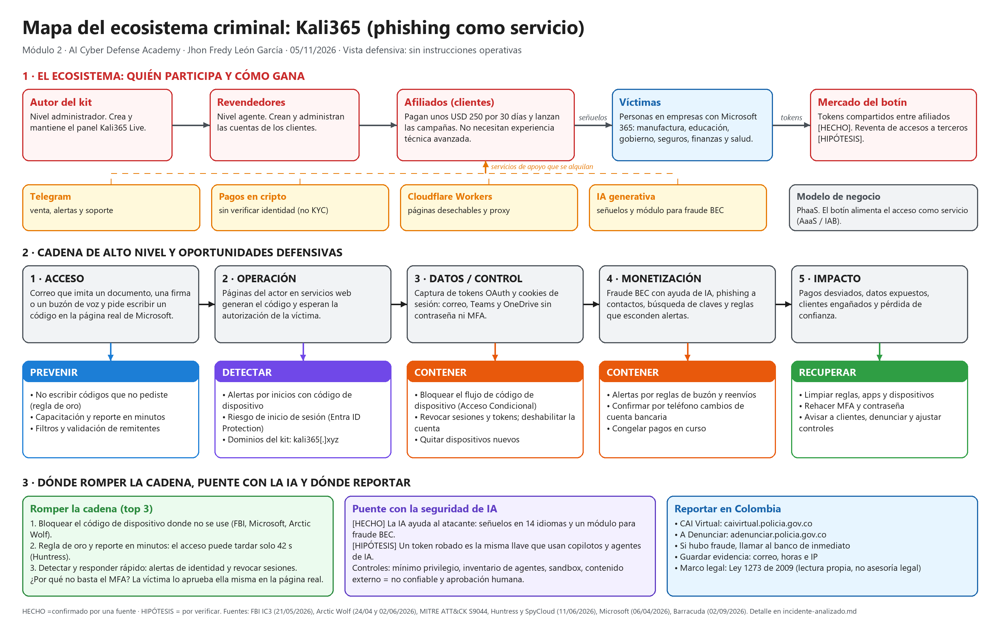

# Módulo 2 · ¿Cómo piensa un adversario?

> **Entregable del módulo:** «Mapa del ecosistema criminal + Incident Brief». Lo pidió el profesor en la clase del 05/11/2026 (Módulo 2, Sesión 2).
> **Caso:** Kali365, kit de phishing como servicio que roba sesiones de Microsoft 365.
> **Regla:** representar la cadena de forma **no operativa** y separar hechos de hipótesis.

| Archivo | Qué contiene | Estado |
|---|---|---|
| [incidente-analizado.md](incidente-analizado.md) | Ficha del caso, hechos e hipótesis, cadena de alto nivel con MITRE ATT&CK (S9044), matriz prevenir / detectar / contener / recuperar, dónde romper la cadena, ecosistema criminal, puente con la seguridad de IA, dónde reportar y fuentes | ✅ |
| [linea-tiempo.md](linea-tiempo.md) | Línea de tiempo de febrero a noviembre de 2026, con la fuente de cada fecha | ✅ |
| [mapa-ecosistema.png](mapa-ecosistema.png) | **Entregable 1:** mapa visual con el ecosistema, la cadena, las oportunidades defensivas, el puente con la IA y dónde reportar | ✅ |
| [mapa-ecosistema.excalidraw](mapa-ecosistema.excalidraw) | El mismo mapa, editable en https://excalidraw.com (menú → Abrir) | ✅ |
| [brief-150-palabras.md](brief-150-palabras.md) | **Entregable 2:** el incidente explicado a una pequeña empresa (149 palabras) | ✅ |
| `fortinet-semana-02.md` | Avance en el curso NSE 1 de Fortinet (se publica cuando registre avance real) | ⏳ |

## Qué aprendí en este módulo

- El cibercrimen funciona como un **ecosistema de servicios**: quien crea el kit no es quien ataca, y quien ataca no necesita saber programar.
- La IA **baja la barrera de entrada**: señuelos en muchos idiomas, correos sin errores y ayuda para el fraude BEC.
- Contra Kali365, el MFA tradicional no basta, porque la víctima lo aprueba ella misma. Lo que corta la cadena es **bloquear el flujo de código de dispositivo** y el **criterio humano**: no escribir códigos que no pediste y reportar en minutos.
- El mismo «botín», un token delegado, es la llave que usan los copilotos y agentes de IA. Defender la identidad también es defender la IA.

> *«Estudiamos este ecosistema para romper la cadena antes del impacto. El conocimiento sirve para anticipar y proteger, no para glorificar actores criminales.»* (Presentación del Módulo 2, Sesión 2)
