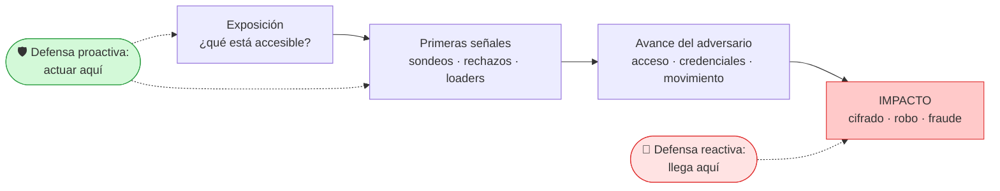

# Técnicas proactivas que he aplicado

**Jhon Fredy León García** · AI Cyber Defense Academy (Campuslands × ETHOS IA Consultores) · actualizado el 10/11/2026

> **Seguridad reactiva:** espera a que el ataque se vea (el ransomware cifró, el dinero salió) y responde.
> **Seguridad proactiva:** se pregunta *"¿resistiríamos?"* y busca las **señales y los controles que aparecen antes del impacto**.

## Las 5 técnicas y dónde las apliqué

| # | Técnica proactiva | Qué significa | Dónde la apliqué | Lo que encontré |
|---|---|---|---|---|
| 1 | **Ventana proactiva** | Poner en una línea de tiempo el momento del impacto y buscar **qué señales y controles existían antes**. | [Laboratorio 1: BragJack](laboratorios/lab-01-ventana-proactiva-bragjack.md) | Una extensión de navegador con permisos comunes podía secuestrar el asistente de IA de 5 navegadores. Las señales tempranas estaban en los **permisos de la extensión** (acceso a todos los sitios y reescritura de tráfico) y en **scripts de un origen ajeno** dentro del dominio de confianza del asistente, antes de cualquier robo de datos. El corte más barato: una **lista blanca de extensiones**. |
| 2 | **Romper la cadena (Attack Flow)** | Dibujar el ataque paso a paso y elegir el **corte más temprano y más barato**. | [Ejercicio M2S1: agente de IA vs. gobierno australiano](ejercicios/m2s1-anatomia-agente-openai-australia.md) | El mejor corte no era "parchear el servidor", sino **darle alcance al agente** (qué puede tocar) y **aprobación humana** cuando cambia de estrategia. |
| 3 | **Reconstruir sin inventar** | Separar **hechos, hipótesis y vacíos** con varias fuentes, antes de decidir qué defender. | [Laboratorio 2: Investigador de incidentes](laboratorios/lab-02-investigador-incidentes.md) · [línea de tiempo](laboratorios/lab-02-linea-de-tiempo.excalidraw) | Con 4 fuentes, varios "hechos" resultaron ser de una sola fuente o estar contradichos. La señal para anticiparse estaba en los logs desde el día 1: **muchos rechazos seguidos de un éxito por otra ruta**. Tardaron 54 días en detectarlo. |
| 4 | **Atacar el eslabón temprano del ecosistema** | El ransomware es el final. Antes hay **loaders y botnets**, y después hay **dinero que lavar**. | Análisis de la lista de buscados del BKA y de Operation First Light 2026 (INTERPOL) | Operation Endgame fue contra los **loaders** (Trickbot, Qakbot, Smokeloader), que abren la puerta a todos los demás. INTERPOL usa **I-GRIP** para frenar el dinero antes de que se lave. |
| 5 | **Defensa contra phishing como servicio** | Estudiar el kit del atacante (MITRE ATT&CK) y cerrar **la técnica**, no solo el correo puntual. | [Aporte proactivo 01: Kali365](aporte-proactivo-01-kali365/README.md) · [Mapa del ecosistema criminal + brief](modulo-02/README.md) (ATT&CK S9044) | Roba sesiones de Microsoft 365 sin necesitar la contraseña. Los controles proactivos son **bloquear el flujo de *device code*** si no se usa, **MFA resistente a phishing** (FIDO2 o passkeys), **vigilar reglas de buzón nuevas** y entrenar en "nunca pegues un código que te pide una página". |

## Mi método (A4D + proactividad)

1. **WHY:** ¿a quién protejo? Personas, organizaciones, confianza.
2. **Exposición:** ¿qué está accesible hoy?
3. **Comportamiento:** ¿qué haría el adversario? Lo mapeo en **MITRE ATT&CK** o **ATLAS**.
4. **Señal temprana:** ¿qué lo delataría **antes** del impacto?
5. **Control:** ¿dónde corto la cadena de forma más temprana y barata?
6. **Documentar:** hechos con fuente, hipótesis marcadas y vacíos declarados.

> Todo el trabajo se hace sobre **casos públicos** o en laboratorios propios o autorizados, como exige el Manifiesto de Ciberdefensa Responsable.
